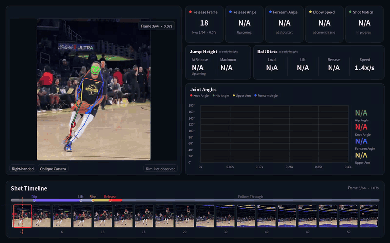

<div align="center">
  
</div>
<h3 align="center"><b>OpenHoopVision Shooting</b></h3>
<p align="center">
  <a href="./README_zh.md"></a>
</p>

**TL;DR:** Built on [OpenHoopVision-core](https://github.com/feifeifei85/OpenHoopVision-core), this project uses its detector and basketball data to analyze a single shot and produce a review video with metrics.

## Demo

<p align="center">
  

*The model classifies this as a one-motion shot: release comes 3 frames (0.10 s) after Lift, at about 75% of peak jump height; the peak (0.14× body height) follows 3 frames later. This compact, low-jump release has an estimated forearm angular speed of 560°/s.*

## Features

- Detect and track the shooter, ball, and visible rim; estimate shooting hand, camera-relative orientation, and camera movement.
- Measure shot timing, release angle, forearm angle and speed, jump height, ball height and speed, and shot motion when evidence is available.
- Render a 3D pose overlay, live joint-angle curves, phase markers, metric cards, and a full-clip timeline.
- Record estimated or unavailable values and their status in `metrics.json`.

## Analysis

RF-DETR detects people, the ball, and the rim; RTMW3D-L estimates body pose. Curves start at Dip when detected, otherwise at the first valid measurement, and update with each frame. The timeline spans the clip and pauses at key shot events.

## Output

Each run processes one video and writes to the current working directory:

| File | Contents |
| --- | --- |
| `output.mp4` | Source video with the dashboard, pose overlay, and timeline. |
| `metrics.json` | Video and scene metadata, shooter estimate, phase events, measurements, and validation details. |

Unsupported values are marked `unavailable`; inferred values retain an estimated status. Per-frame tracking files are not written.

## Run

Use a continuous clip from Dip through Release. For rim-entry analysis, include the ball reaching the basket and keep the player and ball visible.

```bash
cd OpenHoopVision-shooting
python main.py --video /path/to/your_video_clip.mp4
```

English is the default. Use `--lang zh` for Chinese or `--metrics-only` to skip `output.mp4`.

## Project Structure

| Path | Purpose |
| --- | --- |
| `main.py` | Command-line entry point. |
| `pipeline/` | Coordinates video analysis. |
| `models/`, `tracking/` | Model inference and frame-to-frame tracking. |
| `analysis/` | Shot phases, measurements, and validation. |
| `render/` | Dashboard and video output. |
| `core/`, `utils/` | Configuration, shared data, geometry, video input, and output. |
| `config.yaml`, `weights/` | Analysis settings and model checkpoints. |
| `assets/` | Project logo and English/Chinese demo GIFs. |

## Measurement Notes

Angles and image-space motion are video-based estimates affected by camera movement, occlusion, cropping, slow motion, and freezes. Height values are normalized to visible body height when available; they are not physical distances.

## References

- [OpenHoopVision-core](https://github.com/feifeifei85/OpenHoopVision-core) — detector and basketball data used by this project.
- [RF-DETR](https://github.com/roboflow/rf-detr) — object-detection framework.
- [RTMW3D / RTMPose3D](https://github.com/open-mmlab/mmpose/tree/main/projects/rtmpose3d) and its [technical report](https://arxiv.org/abs/2407.08634) — 3D pose model and toolkit.

## License

Original OpenHoopVision code and project-trained models follow the [Apache License 2.0](https://www.apache.org/licenses/LICENSE-2.0) statement in [OpenHoopVision-core](https://github.com/feifeifei85/OpenHoopVision-core#license). Dataset footage, third-party libraries, pretrained weights, and fonts retain their respective terms and rights; the demo does not grant rights to its source video.
