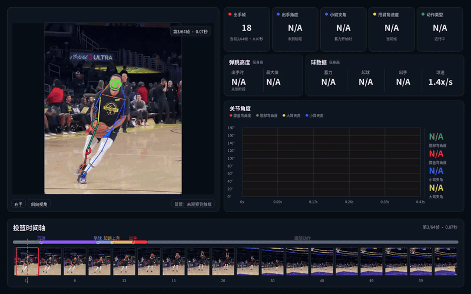

<div align="center">
  
</div>
<h3 align="center"><b>OpenHoopVision Shooting</b></h3>
<p align="center">
  <a href="./README.md"></a>
</p>

**简介：** 本项目基于 [OpenHoopVision-core](https://github.com/feifeifei85/OpenHoopVision-core)，使用其检测模型和篮球数据分析单次投篮，并生成同步复核视频和 `metrics.json`。

## 演示

<p align="center">
  
</p>

*模型将动作估计为一段式投篮：起球后 3 帧（0.10 秒）出手，此时约达到最大弹跳高度的 75%；再过 3 帧到达峰值（身高的 0.14 倍）。这是一种低弹跳、快速出手节奏，甩臂角速度约 560°/秒。*

## 功能

- 检测并跟踪投篮者、篮球和可见篮筐；估计投篮手、球员相对相机的朝向及相机运动。
- 在画面证据充分时测量投篮时刻、出手角度、前臂夹角与角速度、弹跳高度、球的高度与速度及投篮动作指标。
- 生成包含三维姿态骨架、实时角度曲线、阶段标记、指标卡和完整时间轴的看板视频。
- 在 `metrics.json` 中记录指标状态；无法判断或推断得到的数值会分别标记为不可用或估计。

## 分析流程

RF-DETR 检测球员、篮球和篮筐，RTMW3D-L 估计人体姿态。曲线从检测到的 Dip（沉球）开始；未检测到时从首个有效测量开始，并随视频逐帧更新。时间轴覆盖整段视频，并在关键投篮事件处暂停。

## 输出文件

每次运行分析一个视频，结果写入当前工作目录：

| 文件 | 内容 |
| --- | --- |
| `output.mp4` | 叠加看板、姿态骨架和时间轴的原视频。 |
| `metrics.json` | 视频与场景信息、投篮者估计、阶段事件、测量值和校验详情。 |

无法判断的指标标记为 `unavailable`，推断值保留 `estimated` 状态。本项目不写出逐帧跟踪文件。

## 运行

建议使用从 Dip（沉球）到 Release（出手）的连续片段。分析入筐过程时，应保留篮球到达篮筐的画面，并确保球员和篮球可见。

```bash
cd OpenHoopVision-shooting
python main.py --video /path/to/your_video_clip.mp4
```

默认使用英文；`--lang zh` 切换中文，`--metrics-only` 跳过 `output.mp4`。

## 项目结构

| 路径 | 用途 |
| --- | --- |
| `main.py` | 命令行入口。 |
| `pipeline/` | 编排视频分析流程。 |
| `models/`、`tracking/` | 模型推理与逐帧跟踪。 |
| `analysis/` | 投篮阶段、指标计算和结果校验。 |
| `render/` | 生成看板和视频。 |
| `core/`、`utils/` | 配置、共享数据、几何计算、视频读写。 |
| `config.yaml`、`weights/` | 分析配置和模型权重。 |
| `assets/` | 项目标志及中英文演示 GIF。 |

## 测量说明

角度和图像位移是视频估计值，会受到相机运动、遮挡、裁切、慢动作和画面定格影响。可用时，高度按可见身高归一化，不代表实际物理距离。

## 参考资料

- [OpenHoopVision-core](https://github.com/feifeifei85/OpenHoopVision-core)：提供本项目使用的检测模型和篮球数据。
- [RF-DETR](https://github.com/roboflow/rf-detr)：目标检测框架。
- [RTMW3D / RTMPose3D](https://github.com/open-mmlab/mmpose/tree/main/projects/rtmpose3d) 及其[技术报告](https://arxiv.org/abs/2407.08634)：三维姿态模型与工具包。

## 许可证

OpenHoopVision 原始代码和项目训练模型遵循 [OpenHoopVision-core](https://github.com/feifeifei85/OpenHoopVision-core#license) 声明的 [Apache License 2.0](https://www.apache.org/licenses/LICENSE-2.0)。数据集视频、第三方库、预训练权重和字体遵循各自条款与版权；演示 GIF 不授予源视频的使用权。
